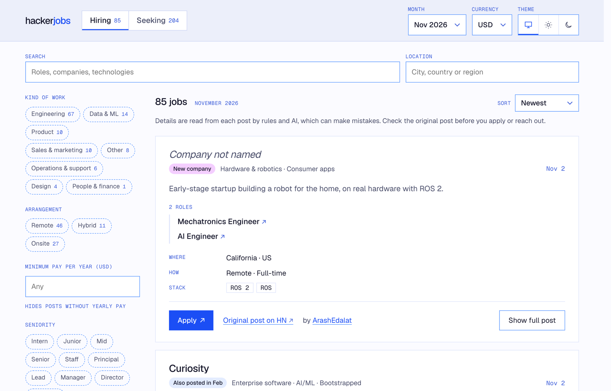
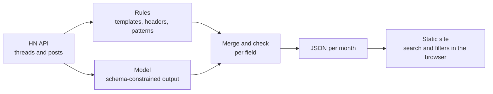

<div align="center">

# hackerjobs

**A job board for Hacker News' monthly _Who is hiring?_ and _Who wants to be hired?_ threads.**

Search and filter every post by role, pay, location, remote work, technologies, company stage and
industry, in one place, with a link back to each original post. 

🔄: **Updated Every Day at 7AM EST.**

[](LICENSE)
[](https://github.com/flaviaouyang/hackerjobs/actions/workflows/pages/pages-build-deployment)

[**Open the board →**](https://flaviaouyang.github.io/hackerjobs/)

<picture>
  <source media="(prefers-color-scheme: dark)" srcset="docs/screenshot-dark.png">
  
</picture>

</div>

## Features

- **Both threads**: jobs from _Who is hiring?_ and candidates from _Who wants to be hired?_,
  from January 2026 on, updated daily.
- **Filters that matter**: kind of work, remote / hybrid / onsite, minimum pay in your currency,
  seniority, technologies, industry, visa sponsorship, equity.
- **Pay in your currency**: ranges converted with the Bank of Canada's latest rates.
- **Across months**: badges for new companies and reposts, and each company's or candidate's
  earlier posts one click away.
- **Fast and private**: a static site with search running in your browser, no account, no
  cookies, light and dark themes.

## How it works



1. **Ingest**: threads posted by the `whoishiring` account and their top-level comments, from the
   [official HN API](https://github.com/HackerNews/API). Deleted and flagged posts are removed.
2. **Parse**: every post is read twice, by rules (the candidate template, the
   `Company | Role | Location` header, pay and email patterns) and by a model that may only copy
   what the post states. For each field, the source that scored better on a
   [labelled benchmark](eval/benchmark.jsonl) wins.
3. **Check**: text the post doesn't contain is dropped; claims like company stage or a consulting
   business need supporting words in the post; technologies get canonical names; companies are
   matched across months by website, then by name.
4. **Publish**: one JSON file per thread and month, served with a static
   [Astro](https://astro.build) site and a single [Preact](https://preactjs.com) island.

Posts in the wrong thread (a candidate in a hiring thread, questions, jokes) are left out.

> [!NOTE]
> Details are read by rules and AI, which can make mistakes. Every entry links to its original
> post: check it before you apply or reach out.

## Privacy

- **Only what's on HN**: the board shows public posts, linked to their author's HN profile.
- **Email addresses stay hidden from scrapers**: many candidates disguise their address
  (`jo [at] example [dot] com`). The board never publishes a decoded address: addresses are
  stored scrambled and turned into a link only when someone hovers, focuses or taps it.
- **Edits and removals follow HN**: delete or edit your post on Hacker News and the board follows
  at its next daily update. To be removed sooner,
  [open an issue](https://github.com/flaviaouyang/hackerjobs/issues).
- **Analytics without tracking**: [GoatCounter](https://www.goatcounter.com) counts page views by
  path (never the search or filters in the URL) and totals of clicks on Apply, Email and Original
  post. No cookies, no IP addresses stored.

## Run it yourself

You need Python 3.12+ with [uv](https://docs.astral.sh/uv/), [Bun](https://bun.sh), and a model:

- **[LM Studio](https://lmstudio.ai)**, free and local, with any model that supports structured
  output, or
- **the Anthropic API**: set `ANTHROPIC_API_KEY`. Parsing every post since January 2026 with
  Claude Haiku costs about $3.

```sh
uv sync
(cd web && bun install)

uv run hackerjobs sync     # ingest, exchange rates, parse, export
cd web && bun run dev      # http://localhost:4321/hackerjobs/
```

`sync` only parses posts it hasn't parsed before, so running it again is cheap. The database
(`data/`) and the exported data (`web/public/data/`) are not committed.

### Configuration

Settings live in [`hackerjobs.toml`](hackerjobs.toml):

| Setting | Meaning |
| --- | --- |
| `since` | First month to ingest (`YYYY-MM`) |
| `parse.models` | Models to parse with, as `provider:model`, e.g. `anthropic:claude-haiku-5-5` or `lmstudio:qwen/qwen3.8-27b` |
| `publish.models` | Whose extractions go on the site, in order of preference: each post uses the first model that has parsed it |
| `review` | Optional: have one model review another's extractions |
| `anthropic.concurrency`, `lmstudio.concurrency` | Parallel requests per provider |
| `lmstudio.url` | LM Studio's server address |

### Commands

| Command | What it does |
| --- | --- |
| `hackerjobs ingest` | Fetch threads and posts from Hacker News |
| `hackerjobs fx` | Fetch the latest exchange rates |
| `hackerjobs parse` | Extract fields from posts not yet parsed at the current prompt version |
| `hackerjobs review` | Review one model's extractions with another |
| `hackerjobs export` | Write the site's data files |
| `hackerjobs sync` | Ingest, fx, parse, review (if configured) and export, in order |
| `hackerjobs eval` | Score extraction on the labelled benchmark, per field and per source |
| `hackerjobs companies` | List similar company names that are kept apart, for review |

Add `--help` to any of them for options.

### Scripts

| Script | What it does |
|---|---|
| `scripts/deploy.sh` | Build the site and publish it to GitHub Pages |
| `scripts/backup.sh` | Snapshot the database, gzipped, into `~/Backups/hackerjobs` (`HACKERJOBS_BACKUP_DIR` to change), keeping the newest 14 |
| `scripts/daily.sh` | Start LM Studio's server, sync, back up and deploy |
| `scripts/install-daily.sh` | Run `daily.sh` every day with launchd (at 7:00, or the hour given) |

To restore a backup: `gunzip -c hackerjobs-YYYY-MM-DD.db.gz > data/hackerjobs.db`. The database
holds decoded email addresses, so keep backups in private storage only.

## Development

```sh
uv run pytest                                      # Python tests
uv run ruff check . && uv run ruff format --check .

cd web
bun test                                           # site logic tests
bun run check                                      # type check
bun run build                                      # static site in web/dist/
```

CI runs all of these on every push and pull request. Changing a prompt or the output schema
changes that thread kind's prompt version, so the next `parse` re-parses only that kind; run
`hackerjobs eval` before and after to compare.

Production builds load GoatCounter with the site code in `web/.env.production`; `bun run dev`
has no analytics, and GoatCounter ignores visits from localhost.

## Acknowledgements

Posts come from [Hacker News](https://news.ycombinator.com) and its
[`whoishiring`](https://news.ycombinator.com/submitted?id=whoishiring) threads; exchange rates
from the [Bank of Canada](https://www.bankofcanada.ca/rates/exchange/).

## License

[MIT](LICENSE) © Flavia Ouyang. Posts belong to their authors on Hacker News.
